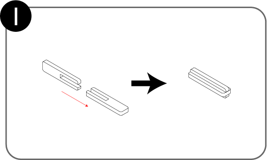
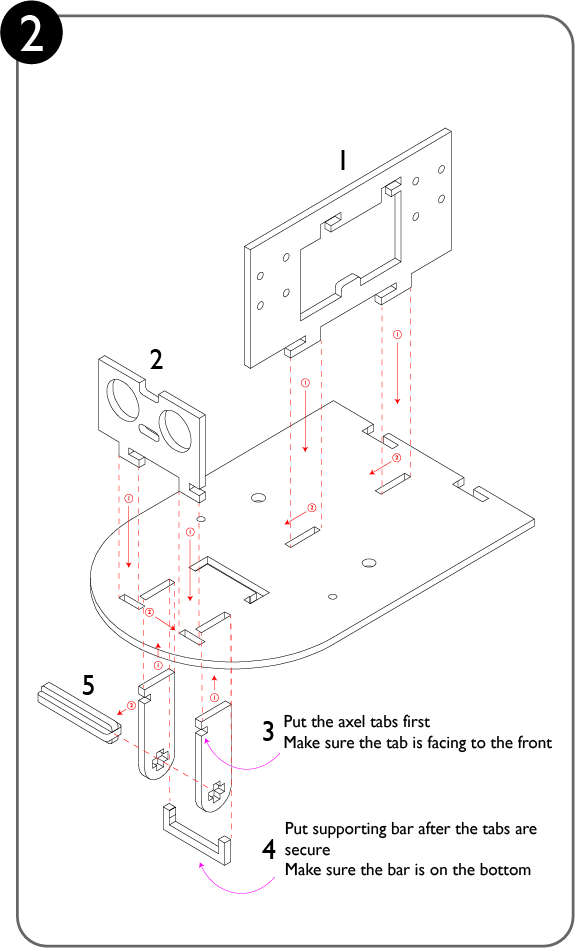
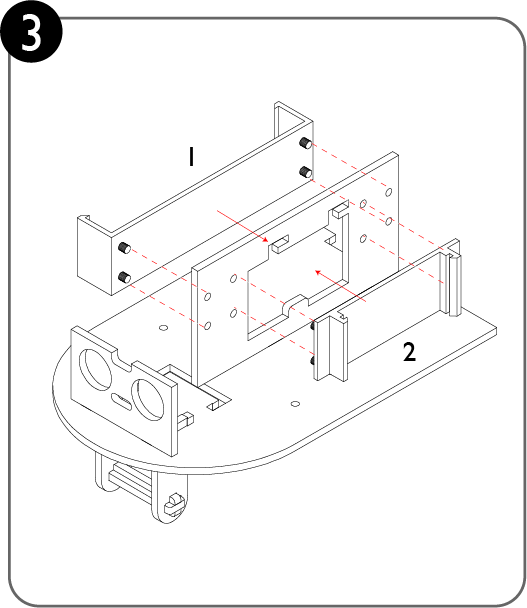
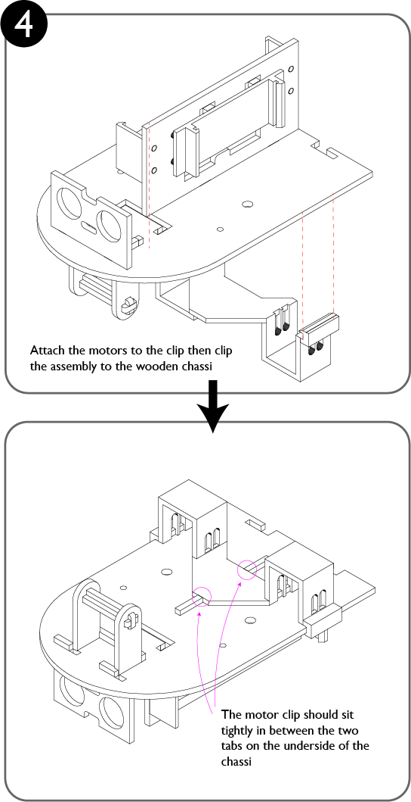
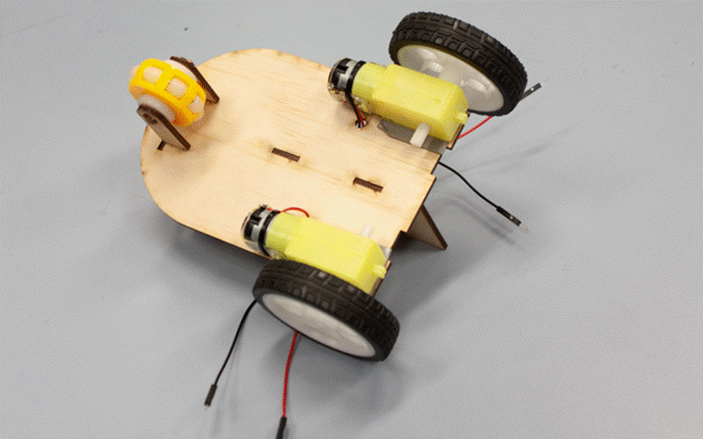
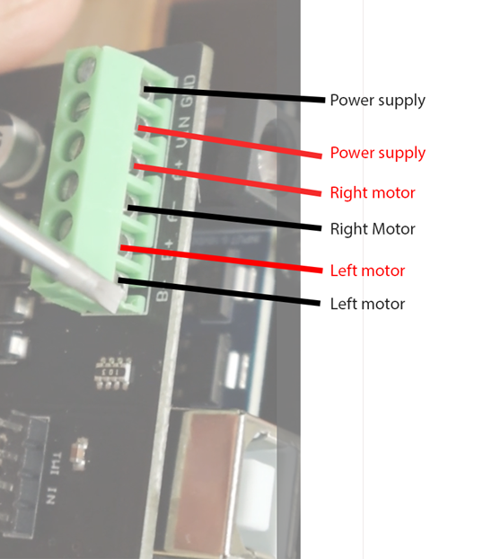
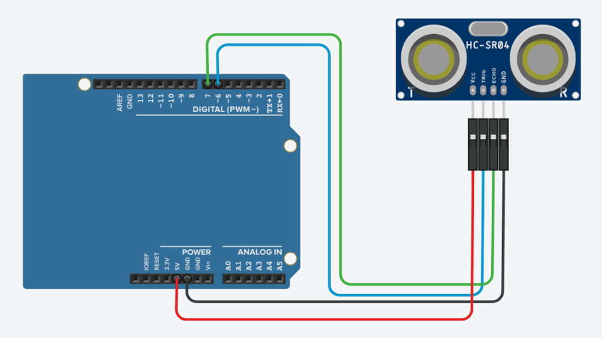
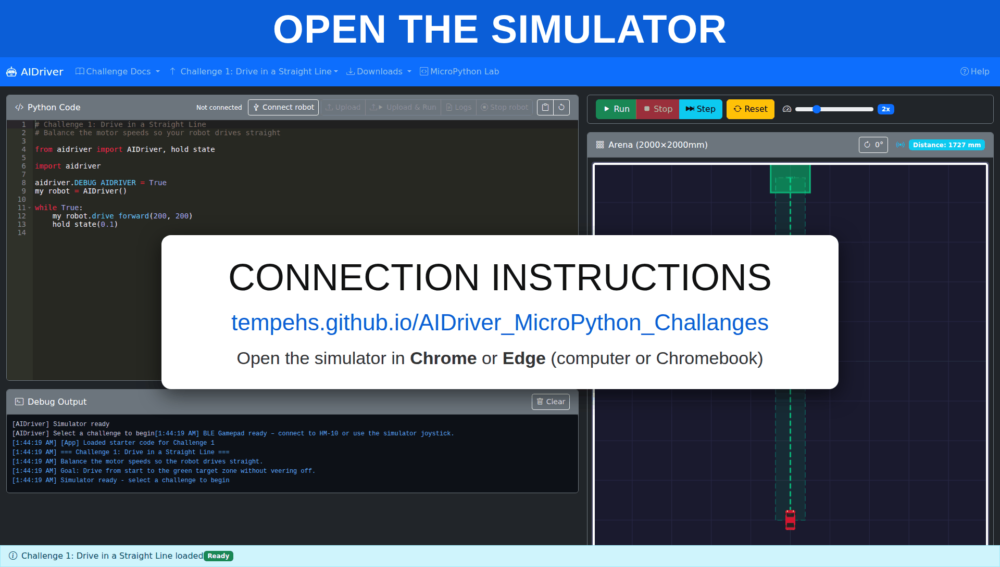
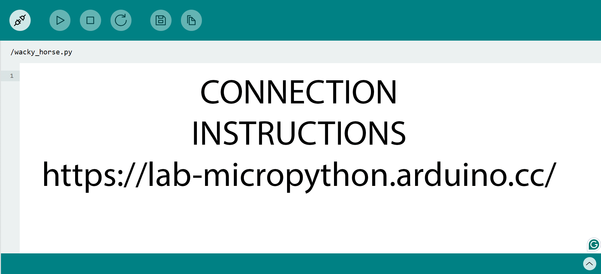

# Assembly Instructions

> [!Important]
> Before students begin, they should know:
>
> 1. During assembly, no parts should be forced, excessive force will break the components.
> 2. The motors should not be manually turned as it will break the plastic gears (that means no pushing and pulling the robot on the ground like a Tonka truck).
> 3. The robots battery power should always be turned off when connecting to a computer.
> 4. Make sure your robot has room to move and won't be stepped on when testing.
> 5. Batteries should be always removed for storage

## Step 1

**Assemble the axle for the front wheel.**



## Step 2

**Slide the omni wheel onto the middle of the axle.**


**Assemble the main chassis.**



## Step 3

**Attach the 3D Printed brackets for the battery holder and Microcontroller.**



## Step 4

**First insert the two motors into the 3D motor clip.**


**Second attach the motor clip to the chassis.**



## Step 5

**Attach the wheels to the motors.**



## Step 6

**Connect the wires to the screw terminals.**



## Step 7

**Attach the ultrasonic sensor to the robot and connect it to the processor.**



## Step 8 - Test the Hardware

Upload the hardware test program to your robot as `main.py`, then run it. If you can't use the simulator, see [Upload from Arduino MicroPython Lab](#upload-from-arduino-micropython-lab) at the bottom of this page.

> [!Caution]
> Keep the battery power switch **off** while the robot is plugged into a computer. To avoid damaging your computer or robot, unplug the USB cable and place the robot on the floor, in an area with enough space for it to move safely, before switching the battery on.

### Upload from the AIDriver Simulator

You need **Chrome** or **Edge** on a computer or Chromebook (Firefox and Safari can't connect to the robot).

1. Make sure your battery power switch is off.
2. Open the [AIDriver Simulator](https://tempehs.github.io/AIDriver_MicroPython_Challanges/simulator.html).
3. Plug your robot into your computer with a USB cable.
4. Press **Connect robot** above the code editor.
5. Select your robot in the list (usually **Board CDC** followed by a port such as `COM5`) and press **Connect**.
6. Check the status says **Pico connected** and the debug panel says `Connected to robot: Raspberry Pi Pico · MicroPython … · AIDriver …`.
7. From the challenge menu choose **Debug Script**. The hardware test program loads into the editor.
8. Press **Upload** and wait for `✅ Uploaded to robot as main.py`.
9. Unplug the USB cable, put the robot on the floor and switch the battery on.



> [!Note]
> If the status says **Firmware update needed**, or the robot won't connect, give your robot to your teacher to install the AIDriver firmware. For other messages see [Common Errors - Problems uploading from the simulator](Common_Errors.md#9-problems-uploading-from-the-simulator).

### What the robot should do

After you switch the battery on, the robot waits 3 seconds, then:

1. Drives forward for 2 seconds.
2. Drives backward for 2 seconds.
3. Rotates right for 2 seconds.
4. Rotates left for 2 seconds.
5. Takes five distance readings with the ultrasonic sensor.

Each test is recorded in the robot's `event_log.txt`. To read it, reconnect the robot (battery off) and press **Logs** in the simulator, or open the file in Arduino MicroPython Lab.

### Upload from Arduino MicroPython Lab

<details>
<summary>Use this if you can't use the simulator (click to show the steps)</summary>

1. With the battery off, open [Arduino MicroPython Lab](https://lab-micropython.arduino.cc/), sign in with your @education.nsw.gov.au Google account and connect your robot:

   

2. Open `main.py`, replace its contents with the hardware test code below and click <kbd>SAVE</kbd>.
3. Unplug the robot, put it on the floor and switch the battery on.

```python
from aidriver import AIDriver, hold_state
import aidriver

"""Hardware sanity test for the AIDriver robot.

Runs a short sequence of movements and distance readings.
Most details are reported via the AIDriver debug logger.
"""

aidriver.DEBUG_AIDRIVER = True

print("Initialising AIDriver hardware test...")

try:
    robot = AIDriver()
except Exception as exc:
    print("Failed to initialise AIDriver:", exc)
    print("Check that 'aidriver.py' is in the 'lib' folder on the device.")
    raise SystemExit

print("Starting tests in 3 seconds. Ensure clear space around the robot.")
hold_state(3)

# Test 1: Drive Forward
print("Test 1: drive_forward")
robot.drive_forward(200, 200)
hold_state(2)
robot.brake()
hold_state(1)

# Test 2: Drive Backward
print("Test 2: drive_backward")
robot.drive_backward(200, 200)
hold_state(2)
robot.brake()
hold_state(1)

# Test 3: Rotate Right
print("Test 3: rotate_right")
robot.rotate_right(200)
hold_state(2)
robot.brake()
hold_state(1)

# Test 4: Rotate Left
print("Test 4: rotate_left")
robot.rotate_left(200)
hold_state(2)
robot.brake()
hold_state(1)

# Test 5: Ultrasonic Sensor
print("Test 5: ultrasonic distance readings")
for i in range(5):
    distance = robot.read_distance()
    hold_state(0.5)

print("All hardware tests completed.")
```

</details>
